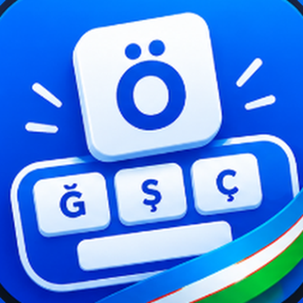
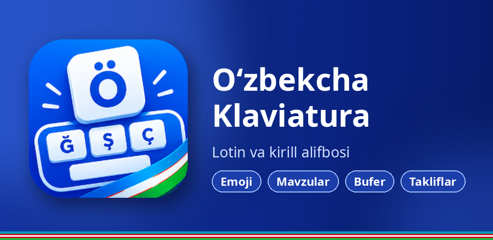

<p align="center"></p>

# Yangi Oʻzbek Klaviaturasi (Yangi Uzb Key)

Android uchun oʻzbekcha klaviatura: lotin va kirill yozuvi, soʻz takliflari, ovozli kiritish va chiroyli mavzular.



## Imkoniyatlar

- Oʻzbek (lotin va kirill), rus, ingliz, qozoq va turk tillari; oʻ / gʻ avtomatik tuzatish
- Soʻz takliflari va lugʻat, lugʻatni eksport/import qilish
- Barmoqni sirpantirib yozish (glide typing) va ovozli kiritish
- Mavzular va **Tugmalar dizayni**: 9 ta tugma uslubi (Toʻldirilgan, Boʻrtma, Gradient, Kapsula, Shisha, Neon, Kontur, Chiziqcha, Yassi), burchak, oraliq va shrift oʻlchami
- 3 sahifali belgilar paneli, uzoq bosishda qoʻshimcha belgilar, emoji
- Bir qoʻl rejimi, tahrirlash paneli, bufer (clipboard), qisqartmalar, maxfiy (incognito) rejim
- Asboblar panelini sozlash, telefon raqami va raqamli maydonlar uchun maxsus klaviaturalar

Talablar: Android 7.0 (API 24) va undan yuqori.

## Yuklab olish

Tayyor APK/AAB fayllar [Releases](../../releases) boʻlimida.

## Yigʻish (build)

JDK 21 va Android SDK (compileSdk 36) kerak.

```bash
./gradlew assembleDebug            # debug APK
./gradlew assembleRelease bundleRelease   # imzolangan release (keystore kerak)
```

Release imzosi uchun `keystore.properties.example` faylidan nusxa olib `keystore.properties` yarating
(u gitga qoʻshilmaydi) yoki muhit oʻzgaruvchilaridan foydalaning:
`YUK_KEYSTORE_FILE`, `YUK_KEYSTORE_PASSWORD`, `YUK_KEY_ALIAS`, `YUK_KEY_PASSWORD`.

## GitHub Actions

- `Build` — har bir push va pull request uchun yigʻadi.
- `Release` — `v*` tegi push qilinganda (masalan `v1.0.7`) Release yaratib, APK/AAB ni biriktiradi.

Imzolangan release uchun repozitoriy sozlamalarida (Settings → Secrets and variables → Actions)
`KEYSTORE_BASE64`, `KEYSTORE_PASSWORD`, `KEY_ALIAS`, `KEY_PASSWORD` sirlarini qoʻshing.
Ular boʻlmasa, Release ichiga debug APK qoʻyiladi.

## Tuzilishi

| Papka | Tarkibi |
|---|---|
| `app/src/main/java/uz/yangiuzbkey/keyboard/ime` | Klaviatura xizmati (InputMethodService) |
| `app/src/main/java/uz/yangiuzbkey/keyboard/keyboard` | Tugmalar, maketlar, chizish |
| `app/src/main/java/uz/yangiuzbkey/keyboard/settings` | Sozlamalar ekranlari |
| `app/src/main/java/uz/yangiuzbkey/keyboard/theme` | Mavzular va tugma uslublari |
| `app/src/main/assets` | Lugʻatlar va emoji |
| `tools/` | Lugʻat (`mkdict.py`) va ikonka (`mkicons.py`) generatorlari |
| `store/` | Play Market rasmlari va logotip |
